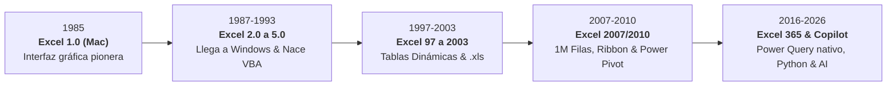
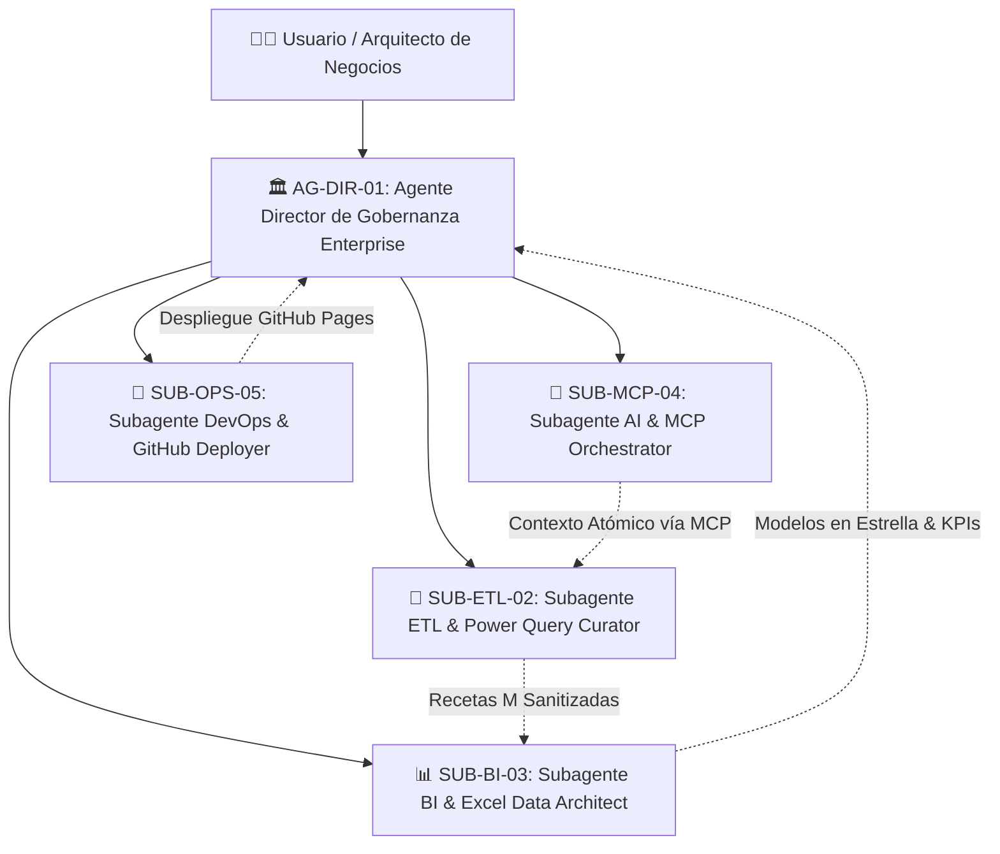

# 📊 Manual Pedagógico ETL para Power Query & Microsoft Excel 365
## 🏆 Sistema Empresarial de Curaduría de Datos, Arquitectura Analítica, IA & Gobernanza Multi-Agente
**Versión Actual:** `v6.0-PRO (Master Enterprise & AI Release)`  
**Autor & Arquitecto:** Ing. Juancito Peña Vizcaíno  
**Repositorio GitHub:** [https://github.com/JUANCITOPENA/Manual-Pedagogico-ETL-PowerQuery-Excel](https://github.com/JUANCITOPENA/Manual-Pedagogico-ETL-PowerQuery-Excel)  
**Despliegue en Vivo (GitHub Pages):** [https://juancitopena.github.io/Manual-Pedagogico-ETL-PowerQuery-Excel/](https://juancitopena.github.io/Manual-Pedagogico-ETL-PowerQuery-Excel/)  
**Ubicación del Proyecto:** `C:\Users\User\Desktop\Manual Pedagógico ETL para Power Query & Excel\`  
**Estado General:** `🟢 100% FUNCIONAL | ESTABLE | BLINDADO | PRODUCCIÓN LISTA | DESPLEGADO EN GITHUB PAGES`

---

## 📌 1. Resumen Ejecutivo y Estatus del Sistema

Este proyecto es una plataforma interactiva de alto impacto pedagógico y profesional, diseñada para la enseñanza, consultoría y capacitación gerencial en **Ingeniería de Datos, Curaduría, Limpieza ETL con Power Query, Modelado con Microsoft Excel 365, Inteligencia Artificial y el Protocolo MCP (Model Context Protocol)**.

Resuelve de raíz la **"Paradoja del ERP/CRM"**: cómo las corporaciones invierten millones en sistemas transaccionales (SAP S/4HANA, Microsoft Dynamics 365, Salesforce, Odoo), pero los directores y analistas siempre deben exportar a Excel para responder preguntas de rentabilidad cruzada, enfrentándose a datos corruptos, faltas ortográficas (leetspeak), espacios fantasma, campos nulos y discrepancias impositivas.

---

## 🟢 2. Microsoft Excel: La Herramienta Indiscutible #1 del Mundo

Microsoft Excel es el software de procesamiento y análisis de datos más utilizado y poderoso del planeta:
- **+1,200 Millones de Usuarios Activos:** Ninguna otra tecnología de datos cuenta con una base de adopción tan masiva y transversal.
- **99.9% de las Fortune 500:** Las decisiones financieras más críticas del mundo se validan en hojas de cálculo de Excel.
- **Bondades Revolucionarias:**
  1. *Cuadrícula Reactiva Instantánea:* Recálculo atómico en milisegundos con fluidez táctil inigualable.
  2. *Power Query & Motor M Integrado:* El estándar dorado de ETL en escritorio. Conecta carpetas, bases de datos y APIs con actualización con un solo clic (`Ctrl + Alt + F5`).
  3. *Power Pivot & Motor Columnar VertiPaq:* Agregaciones ultrarrápidas sobre millones de registros mediante lenguaje DAX.
  4. *Python Nativo en Excel (`=PY()`):* Integración directa de librerías de Data Science (`pandas`, `matplotlib`, `seaborn`) dentro de la propia cuadrícula de celdas.

### ⏳ 4 Décadas de Evolución Histórica de Microsoft Excel (1985 &ndash; 2026)

---

## 🧠 3. El Salto Cuántico: IA, Protocolo MCP & Agentes Autónomos al 100% de Potencial

La Inteligencia Artificial generativa no viene a reemplazar a Excel, sino a **llevar las habilidades analíticas de los profesionales al 100% de su potencial máximo**:
- **Protocolo MCP (Model Context Protocol):** Estándar abierto que permite a los Modelos de Lenguaje (LLMs) conectarse de forma nativa y bidireccional a libros de Excel, esquemas de bases de datos y Power BI, leyendo metadatos y ejecutando transformaciones sin intermediarios.
- **Agentes & Subagentes Autónomos:** Subagentes especializados que operan en segundo plano desinfectando texto corrupto (leetspeak, dobles espacios, nulos), generando código M de Power Query y calculando medidas DAX sin errores.
- **Transformación de Perfil:** El analista evoluciona de un transcriptor manual de celdas a un **Arquitecto y Director de Soluciones Analíticas**.

---

## 🤖 4. Arquitectura de Agentes y Subagentes del Proyecto

El proyecto cuenta con una carpeta dedicada [`agents/`](./agents/) con la especificación completa del comité de gobernanza multi-agente:

- [`agents/INDEX_MAPA_AGENTES.md`](./agents/INDEX_MAPA_AGENTES.md): Catálogo y protocolo de comunicación multi-agente.
- [`agents/AGENTE_DIRECTOR_GOBERNANZA_ENTERPRISE.md`](./agents/AGENTE_DIRECTOR_GOBERNANZA_ENTERPRISE.md): Quality Gates 1 al 7 y auditoría.
- [`agents/SUBAGENTE_ETL_POWER_QUERY_CURATOR.md`](./agents/SUBAGENTE_ETL_POWER_QUERY_CURATOR.md): Curaduría de texto y recetas M.
- [`agents/SUBAGENTE_BI_EXCEL_DATA_ARCHITECT.md`](./agents/SUBAGENTE_BI_EXCEL_DATA_ARCHITECT.md): Esquemas por industria, Chart.js y Pivot Tables.
- [`agents/SUBAGENTE_AI_MCP_ORCHESTRATOR.md`](./agents/SUBAGENTE_AI_MCP_ORCHESTRATOR.md): Protocolo MCP e IA generativa.
- [`agents/SUBAGENTE_DEVOPS_GITHUB_DEPLOYER.md`](./agents/SUBAGENTE_DEVOPS_GITHUB_DEPLOYER.md): Integración continua y GitHub Pages.

---

## 🎯 5. Matriz de Módulos del Sistema Web (`index.html`)

| Módulo / Funcionalidad | Descripción Técnica | Estatus |
| :--- | :--- | :---: |
| **Menú Superior Sticky Fijo** | Barra de navegación en una sola fila compacta con selector de caso de negocio, botón directo a GitHub y descarga de Excel. | `🟢 100% OPERATIVO` |
| **Bloque Magistral Excel #1 & Microsoft** | Icono oficial moderno de Excel, logotipo Microsoft, cifras globales (1,200M usuarios), bondades y 4 pilares. | `🟢 100% OPERATIVO` |
| **Línea de Tiempo Histórica (1985-2026)** | Cronología interactiva con hitos: Excel 1.0, VBA, Pivot Tables, 1M filas Ribbon, Power Pivot, Power Query, Python y Copilot. | `🟢 100% OPERATIVO` |
| **Multiplicador IA, MCP & Agentes** | Explicación profunda del Protocolo MCP, automatización de recetas M y elevación de habilidades técnicas al 100% de potencial. | `🟢 100% OPERATIVO` |
| **1. Arquitectura & La Paradoja ERP** | Narrativa sobre roles de datos (Procesamiento, Análisis, Curador, Data Scientist, Data Engineer) y comparativa de tiempos de curaduría. | `🟢 100% OPERATIVO` |
| **Carrusel Corporativo de ERPs** | Carrusel interactivo automático (cada 5s) y manual con fichas técnicas de SAP S/4HANA, Dynamics 365, Salesforce y Odoo/Macola. | `🟢 100% OPERATIVO` |
| **2. Master ETL: Conexión & Limpieza** | Fuentes (Carpeta, CSV, JSON), Limpieza (Trim/Clean), Caracteres corruptos (Leetspeak), Tipado y 5 Columnas calculadas reales sin DAX. | `🟢 100% OPERATIVO` |
| **Simulador 3D de Tabla Dinámica** | Emulación visual de la lista de campos de Excel, sus 4 cuadrantes (Filtros, Columnas, Filas, Valores) alimentados por columnas de Power Query. | `🟢 100% OPERATIVO` |
| **3. Generador de Datos Multidisciplinario** | Motor estocástico con inyección opcional de impurezas (leetspeak `@/4/3/0`, dobles espacios, nulos, ventanas horarias compuestas). | `🟢 100% OPERATIVO` |
| **5 Esquemas Relacionales Independientes** | 5 estructuras de datos desacopladas (Retail, Logística, Finanzas, RRHH, Salud) con columnas, cálculos y lógicas exclusivas. | `🟢 100% OPERATIVO` |
| **Tabla de Previsualización (Tab 3)** | Encabezados (`<thead>`) y celdas (`<tbody>`) dinámicos según el esquema activo, con insignias de estatus e iconos de advertencia en impurezas. | `🟢 100% OPERATIVO` |
| **4. Dashboard Ejecutivo Reactivo** | Panel con Sidebar izquierdo de Slicers y área principal con 6 KPIs y 4 gráficos homólogos de Excel 365 con Chart.js. | `🟢 100% OPERATIVO` |
| **Muestra de Datos en Vivo del Dashboard** | Tabla integrada en la parte inferior del Dashboard que muestra las 9 columnas críticas del sector y reacciona a los segmentadores en tiempo real. | `🟢 100% OPERATIVO` |
| **Segmentadores (Slicers) de Excel 365** | 3 slicers con títulos dinámicos adaptados a cada industria (Rutas, Sucursales, Plantas, ARS, Tramos de Mora) y botones interactivos. | `🟢 100% OPERATIVO` |
| **5. Tabla Dinámica Analítica (Tab 5)** | Motor de agregación multidimensional al vuelo que permite cambiar la dimensión de corte y totaliza con pie corporativo. | `🟢 100% OPERATIVO` |
| **Exportaciones Nativas** | Generación de `.xlsx` (2 hojas: Datos crudos + Receta M), `.csv` (UTF-8 con BOM `\uFEFF`) y `.json` sanitizado sin campos internos. | `🟢 100% OPERATIVO` |
| **Diseño UI/UX Light Mode** | Cumplimiento estricto del 85% de ancho maestro (`master-wrapper`), colores Excel verde esmeralda (`#107c41`), slate y azul institucional. Cero modo dark. | `🟢 100% OPERATIVO` |

---

## 🏢 6. Detalle de los 5 Esquemas Relacionales Independientes

1. **🛒 Supermercado & Retail Masivo (`retail`):** Facturas, clientes, vendedores, productos, ITBIS 18%, costo total, margen bruto y estatus de factura.
2. **🚚 Logística, Fletes & Cadena de Suministro (`logistica`):** Manifiestos de carga, rutas territoriales, choferes, tonelaje transportado, tarifas y peajes.
3. **💳 Finanzas Corporativas & Cuentas por Cobrar (`finanzas`):** Pagarés, deudores, sucursales, tramos de mora (0-30d, 31-60d, 61-90d, +90d), intereses y abonos recuperados.
4. **👥 Recursos Humanos & Planilla Multisucursal (`rrhh`):** Colaboradores, sedes de planta, retenciones de ley dominicanas (AFP 2.87%, SFS 3.04%, ISR), aporte patronal TSS (14.19%) y sueldo neto.
5. **🏥 Salud, Clínicas & Coberturas ARS (`salud`):** Autorizaciones de seguros, médicos especialistas, aseguradoras ARS, procedimiento, cobertura y copagos de pacientes.

---

## 🚀 7. Despliegue y Acceso

### 🌐 Opción A: Acceso en la Nube (GitHub Pages)
Ingresa directamente desde cualquier navegador web en tu computadora, tablet o móvil:  
👉 **[https://juancitopena.github.io/Manual-Pedagogico-ETL-PowerQuery-Excel/](https://juancitopena.github.io/Manual-Pedagogico-ETL-PowerQuery-Excel/)**

### 💻 Opción B: Ejecución Local
Hacer doble clic directamente en el archivo:  
`C:\Users\User\Desktop\Manual Pedagógico ETL para Power Query & Excel\index.html`

---

## 🔒 8. Gobernanza y Control de Calidad
- **Sintaxis de JavaScript:** Verificada y validada con compilador Node.js (`0 errores`).
- **Aislamiento de Entorno:** Trabajo acotado estrictamente a la carpeta del proyecto (Sandbox respetado).
- **Compatibilidad:** 100% responsive (desde 320px hasta pantallas UltraWide 4K), 100% Light Theme corporativo.
- **Workflow CI/CD:** Pipeline de GitHub Actions en `.github/workflows/deploy.yml` para despliegue automatizado.

---
*Manual y Sistema desarrollado con los más altos estándares de Gobernanza de Software y Analítica de Datos por el Ing. Juancito Peña Vizcaíno.*
