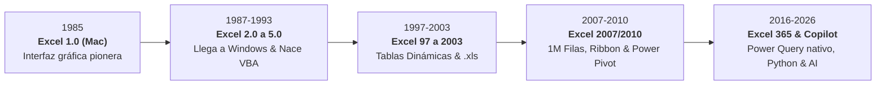

# 📊 Manual Pedagógico ETL para Power Query & Microsoft Excel 365
## 🏆 Sistema Empresarial de Curaduría de Datos, Arquitectura Analítica, IA & Gobernanza Multi-Agente
**Versión Actual:** `v6.2-PRO (Master Enterprise, AI, 3D Pivot & Resilient Navigation Release)`  
**Fecha de Publicación:** 22 de Octubre de 2026  
**Autor & Arquitecto:** Ing. Juancito Peña Vizcaíno  
**Repositorio GitHub:** [https://github.com/JUANCITOPENA/Manual-Pedagogico-ETL-PowerQuery-Excel](https://github.com/JUANCITOPENA/Manual-Pedagogico-ETL-PowerQuery-Excel)  
**Despliegue en Vivo (GitHub Pages):** [https://juancitopena.github.io/Manual-Pedagogico-ETL-PowerQuery-Excel/](https://juancitopena.github.io/Manual-Pedagogico-ETL-PowerQuery-Excel/)  
**Ubicación del Proyecto:** `C:\Users\User\Desktop\Manual Pedagógico ETL para Power Query & Excel\`  
**Estado General:** `🟢 100% FUNCIONAL | ESTABLE | BLINDADO | PRODUCCIÓN LISTA | DESPLEGADO EN GITHUB PAGES`

---

## 📌 1. Resumen Ejecutivo y Estatus del Sistema

Este proyecto es una plataforma interactiva de alto impacto pedagógico y profesional, diseñada para la enseñanza, consultoría y capacitación gerencial en **Ingeniería de Datos, Curaduría, Limpieza ETL con Power Query, Modelado con Microsoft Excel 365, Inteligencia Artificial y el Protocolo MCP (Model Context Protocol)**.

Resuelve de raíz la **"Paradoja del ERP/CRM"**: cómo las corporaciones invierten millones en sistemas transaccionales (SAP S/4HANA, Microsoft Dynamics 365, Salesforce, Odoo), pero los directores y analistas siempre deben exportar a Excel para responder preguntas de rentabilidad cruzada, enfrentándose a datos corruptos, faltas ortográficas (leetspeak), espacios fantasma, campos nulos y discrepancias impositivas.

---

## 🟢 2. Microsoft Excel: La Herramienta Indiscutible #1 del Mundo

Microsoft Excel es el software de procesamiento y análisis de datos más utilizado y poderoso del planeta:
- **+1,200 Millones de Usuarios Activos:** Ninguna otra tecnología de datos cuenta con una base de adopción tan masiva y transversal.
- **99.9% de las Fortune 500:** Las decisiones financieras más críticas del mundo se validan en hojas de cálculo de Excel.
- **Bondades Revolucionarias:**
  1. *Cuadrícula Reactiva Instantánea:* Recálculo atómico en milisegundos con fluidez táctil inigualable.
  2. *Power Query & Motor M Integrado:* El estándar dorado de ETL en escritorio. Conecta carpetas, bases de datos y APIs con actualización con un solo clic (`Ctrl + Alt + F5`).
  3. *Power Pivot & Motor Columnar VertiPaq:* Agregaciones ultrarrápidas sobre millones de registros mediante lenguaje DAX.
  4. *Python Nativo en Excel (`=PY()`):* Integración directa de librerías de Data Science (`pandas`, `matplotlib`, `seaborn`) dentro de la propia cuadrícula de celdas.

### ⏳ 4 Décadas de Evolución Histórica de Microsoft Excel (1985 &ndash; 2026)

---

## 👥 3. Roles de Datos, Matriz de Seniority & Mercado Laboral Global

Previo al análisis técnico, el sistema incorpora una exhaustiva sección pedagógica sobre el ecosistema de talento en datos y el impacto económico de dominar Excel moderno con habilidades en Inteligencia Artificial:

### 3.1. Los 6 Niveles de Seniority y Competencias
1. **Data Entry & Procesador de Datos (Junior):** Digitación y captura manual en plantillas predefinidas.
2. **Técnico de Soporte & Operador de Reportes (Semi-Senior):** Consolidación con funciones intermedias (`BUSCARV`/`XLOOKUP`, tablas de contingencia).
3. **Curador de Datos & Especialista ETL (Senior):** Higiene de datos profesional, normalización M en Power Query, desinfección de leetspeak y automatización con conexión a carpetas.
4. **Analista de Datos & Business Intelligence (Lead / Specialist):** Modelos en estrella, medidas DAX, Tablas Dinámicas analíticas y tableros de control ejecutivos.
5. **Científico de Datos (Senior / Principal):** Modelado predictivo, scripts de Python nativo en Excel (`=PY()`), clustering y proyecciones estocásticas.
6. **Ingeniero de Datos & Arquitecto IA / MCP (Director / Enterprise Architect):** Pipelines corporativos, integración de Model Context Protocol (MCP), subagentes autónomos y gobernanza de datos enterprise.

### 3.2. Tabla Salarial Comparativa (Anual en USD)
| Nivel / Rol Profesional | Excel Tradicional | Con Power Query + Skills IA & MCP | Prima Salarial IA (%) | Rango LATAM / RD | Rango USA / Global |
| :--- | :---: | :---: | :---: | :---: | :---: |
| **Data Entry / Auxiliar de Datos** | $36,000 | $42,000 | **+16.7%** | $6,000 - $10,000 | $35,000 - $45,000 |
| **Técnico Soporte / Analista Jr** | $51,000 | $68,000 | **+33.3%** | $12,000 - $18,000 | $55,000 - $75,000 |
| **Curador ETL / Especialista M** | $72,000 | $92,000 | **+27.8%** | $22,000 - $35,000 | $80,000 - $105,000 |
| **Analista de BI / Modelador Excel** | $95,000 | $120,000 | **+26.3%** | $35,000 - $55,000 | $105,000 - $135,000 |
| **Científico de Datos / Python** | $130,000 | $160,000 | **+23.1%** | $50,000 - $80,000 | $140,000 - $185,000 |
| **Arquitecto IA, MCP & Datos** | $150,000 | $225,000 | **+50.0%** | $75,000 - $120,000 | $190,000 - $260,000 |

*Fuentes Verificadas: Glassdoor Data Science & Analytics Compensation Benchmark 2025/2026, LinkedIn Workforce Intelligence Report, Michael Page International Salary Guide y CompTIA Tech Hiring Insights.*

### 3.3. Gráficos Analíticos Integrados y Visor HD (`img/img1.png`)
- Dos gráficos interactivos con **Chart.js** (Comparativa Salarial de Brecha Tecnológica y Crecimiento de Demanda Laboral 2026-2028).
- Infografía de síntesis [`img/img1.png`](./img/img1.png) con apertura directa en visor Lightbox al 95% de la pantalla.

---

## 🖼️ 4. Flujo Maestro ETL en Power Query & Galería Lightbox (Tab 2)

En la sección **2. Manual ETL**, se implementó un **Card Group al 100% de ancho** con las infografías del flujo maestro:
1. **Conexión & Origen de Datos (`img/img2.png`):** Ingestión desde carpetas locales de red, CSVs transaccionales y bases de datos relacionales con actualización mediante un clic (`Ctrl + Alt + F5`).
2. **Desinfección & Purificación M (`img/img3.png`):** Limpieza de espacios invisibles, tipado regional de fechas, remoción de nulos y neutralización de leetspeak.
3. **Cálculos & Columnas Personalizadas (`img/img4.png`):** Construcción de métricas financieras (Subtotales, ITBIS 18%, Costo Total, Margen Bruto y Porcentajes) directamente en Power Query listas para Tablas Dinámicas.

### 🔍 Visor Modal Lightbox al 95% de Pantalla
- Visualización inmersiva al **95% del total de la pantalla**.
- Controles de navegación interactivos (Anterior / Siguiente).
- Botón de cierre (`X`) de alto contraste y soporte de tecla `Escape`.
- Botón de descarga en alta resolución del diagrama activo.

---

## 🧊 5. Manual Ilustrado 3D de Tablas Dinámicas (Metodología TutsPlus - Tab 5)

Basado en las mejores prácticas de la guía pedagógica de *Envato TutsPlus (CMS-28571)*, el módulo **5. Tabla Dinámica** fue completamente transformado en un **Manual Ilustrado Paso a Paso con Modelado 3D Isométrico**, contextualizado 100% sobre el primer set de datos de **Supermercado & Retail Masivo**:

### 5.1. Modelado Isométrico 3D de Cuadrantes
- **Capa 1 (Datos Planos Crudos):** Las 1,000 transacciones tabulares del supermercado.
- **Capa 2 (Panel Lateral de Campos & Cuadrantes 3D en Relieve):**
  - 🔻 **Filtros de Informe:** `CANAL_VENTA` (Sucursal, Preventa Ruta, App Móvil).
  - 🏛️ **Columnas:** `ESTATUS_FACTURA` (Pagada, Pendiente, Cancelada).
  - 📋 **Filas:** `REGION` (Cibao, Este, Norte, Sur) y `CATEGORIA_PRODUCTO`.
  - 🔢 **Valores:** Suma de `TOTAL_VENTA`, Suma de `MARGEN_BRUTO` y Promedio de `% Cumplimiento Meta`.
- **Capa 3 (Matriz Ejecutiva Agregada):** Cuadrícula gerencial final con subtotales y totales consolidados.

### 5.2. Las 8 Fases Guiadas de Aprendizaje
1. **Higiene Previa del Set de Datos:** Verificar encabezados únicos, sin celdas combinadas ni filas vacías.
2. **Inserción de la Tabla Dinámica:** Atajos clave (`Alt + N + V` o `Insertar > Tabla Dinámica`).
3. **Anatomía del Panel de Campos:** Comprensión de los 4 cuadrantes.
4. **Construcción de la Primera Vista de Retail:** Agrupación por Región y Categoría.
5. **Configuración de Campos de Valor:** Cambiar de Recuento a Suma, Promedio y Formato de Moneda RD$.
6. **Agrupación Cronológica Automática:** Fechas agrupadas en Años, Trimestres y Meses.
7. **Diseño & Formato Tabular:** Aplicar estilo tabular clásico con subtotales en la parte inferior.
8. **Segmentadores (Slicers) & Conexiones:** Control interactivo con segmentadores y actualización mediante `Alt + F5`.

---

## 🛡️ 6. Blindaje de Navegación & Estabilidad de Código (V6.2-PRO)

- **Corrección de Sintaxis ES6:** Se resolvió el error de identificador duplicado `const tbody` en `renderPivotTable()`.
- **Navegación Defensiva (`switchTab`):** Todas las llamadas de renderizado posterior a la navegación (`renderDashboard`, `renderRawTable`, `initSeniorityCharts`, `renderPivotTable`) están envueltas en bloques `try / catch` independientes. Si algún componente secundario reporta advertencias, **la navegación visual de pestañas nunca se bloquea**.
- **Guardia de Chart.js:** Prevención de excepciones en entornos donde la librería externa aún se encuentra cargando (`typeof Chart === 'undefined'`).
- **Validación Sintáctica:** Los 5 scripts de [index.html](file:///C:/Users/User/Desktop/Manual%20Pedagógico%20ETL%20para%20Power%20Query%20&%20Excel/index.html) pasan la compilación estricta de Node.js con `0 errores`.

---

## 🎨 7. Identidad Visual: 100% Light Mode, Tipografía +5% & Bordes Animados

1. **Erradicación Absoluta de Modo Dark:** Cero fondos negros ni contenedores oscuros. Paleta 100% luminosa con blanco puro (`#ffffff`), fondos slate claros (`#f8fafc`) y verde institucional Excel (`#107c41`).
2. **Tipografía Escalada +5%:** Todos los textos, párrafos, tablas, títulos H1-H6, subtítulos, selectores y observaciones incrementados en un 5% matemático (`font-size: 105%` base) para óptima visibilidad docente.
3. **Bordes Animados con Gradiente Continuo:** Implementación de `@keyframes borderGlowLoop` en todas las secciones y cards del sistema, generando un sutil y sofisticado halo corporativo animado.

---

## 🤖 8. Arquitectura de Gobernanza Multi-Agente (`agents/`)

El proyecto cuenta con una carpeta formal [`agents/`](./agents/) con la especificación de los 5 agentes del sistema:
- [`agents/INDEX_MAPA_AGENTES.md`](./agents/INDEX_MAPA_AGENTES.md): Catálogo y protocolo de comunicación multi-agente.
- [`agents/AGENTE_DIRECTOR_GOBERNANZA_ENTERPRISE.md`](./agents/AGENTE_DIRECTOR_GOBERNANZA_ENTERPRISE.md): Quality Gates 1 al 7 y auditoría de sandbox.
- [`agents/SUBAGENTE_ETL_POWER_QUERY_CURATOR.md`](./agents/SUBAGENTE_ETL_POWER_QUERY_CURATOR.md): Curaduría de texto, desinfección leetspeak y recetas M.
- [`agents/SUBAGENTE_BI_EXCEL_DATA_ARCHITECT.md`](./agents/SUBAGENTE_BI_EXCEL_DATA_ARCHITECT.md): Modelado dimensional de 5 industrias, Chart.js y Tablas Dinámicas.
- [`agents/SUBAGENTE_AI_MCP_ORCHESTRATOR.md`](./agents/SUBAGENTE_AI_MCP_ORCHESTRATOR.md): Protocolo MCP e IA generativa orientada a Excel.
- [`agents/SUBAGENTE_DEVOPS_GITHUB_DEPLOYER.md`](./agents/SUBAGENTE_DEVOPS_GITHUB_DEPLOYER.md): Integración continua y GitHub Pages.

---

## 🚀 9. Despliegue y Acceso

### 🌐 Acceso Global en GitHub Pages
👉 **[https://juancitopena.github.io/Manual-Pedagogico-ETL-PowerQuery-Excel/](https://juancitopena.github.io/Manual-Pedagogico-ETL-PowerQuery-Excel/)**

### 💻 Ejecución Local
Abrir con doble clic el archivo principal:  
`C:\Users\User\Desktop\Manual Pedagógico ETL para Power Query & Excel\index.html`

---
*Desarrollado y consolidado bajo los más estrictos estándares de Gobernanza de Software y Analítica de Datos por el Ing. Juancito Peña Vizcaíno.*
