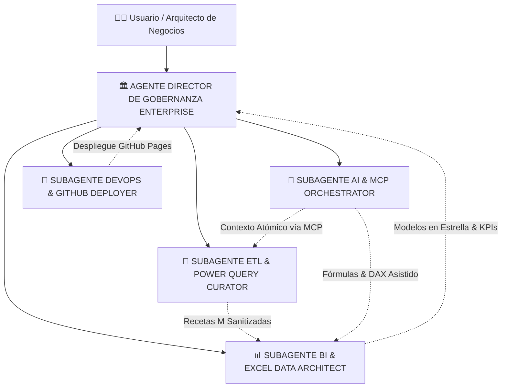

# 🤖 MAPA MAESTRO DE AGENTES & SUBAGENTES DEL PROYECTO
## Plataforma Pedagógica ETL para Power Query, Microsoft Excel 365 & Gobernanza de Datos
**Autor & Arquitecto:** Ing. Juancito Peña Vizcaíno  
**Repositorio Oficial:** `https://github.com/JUANCITOPENA/Manual-Pedagogico-ETL-PowerQuery-Excel`  
**Ubicación en el Proyecto:** `agents/`  
**Fecha:** 2026-10-21  
**Versión:** `v6.0-ENTERPRISE-AGENTS`

---

## 🏛️ 1. Arquitectura Multi-Agente del Sistema

Este proyecto implementa una arquitectura de **Gobernanza Multi-Agente** inspirada en los más altos estándares corporativos. Cada agente y subagente opera con responsabilidades delimitadas, protocolos de comunicación estandarizados y validaciones rigurosas (Quality Gates) para garantizar que la plataforma pedagógica, el código JavaScript/Tailwind, las recetas ETL en lenguaje M, los modelos relacionales y el despliegue en la nube cumplan con una calidad del 100%.

---

## 📋 2. Catálogo de Agentes y Subagentes Especializados

| Identificador | Nombre del Rol | Tipo | Responsabilidad Primaria | Archivo de Especificación |
| :--- | :--- | :---: | :--- | :--- |
| `AG-DIR-01` | **Director de Gobernanza Enterprise** | Agente Principal | Auditoría de Quality Gates (1-7), control de aislamiento Sandbox, UI Light Mode 85%, seguridad OWASP y coherencia metodológica. | [`AGENTE_DIRECTOR_GOBERNANZA_ENTERPRISE.md`](./AGENTE_DIRECTOR_GOBERNANZA_ENTERPRISE.md) |
| `SUB-ETL-02` | **Curador ETL & Power Query** | Subagente Especializado | Generación y auditoría de código M, limpieza estocástica de texto (leetspeak, espacios, nulos), ingestión con Folder Connector y tipado estricto. | [`SUBAGENTE_ETL_POWER_QUERY_CURATOR.md`](./SUBAGENTE_ETL_POWER_QUERY_CURATOR.md) |
| `SUB-BI-03` | **Arquitecto BI & Excel 365** | Subagente Especializado | Modelado analítico relacional de los 5 casos de empresa, diseño de Tablas Dinámicas, Slicers adaptativos, métricas sin DAX y visualización con Chart.js. | [`SUBAGENTE_BI_EXCEL_DATA_ARCHITECT.md`](./SUBAGENTE_BI_EXCEL_DATA_ARCHITECT.md) |
| `SUB-MCP-04` | **Orquestador AI & Protocolo MCP** | Subagente Especializado | Integración del protocolo Model Context Protocol (MCP) para conectar LLMs con libros de Excel y esquemas relacionales, habilitando el 100% de potencial técnico. | [`SUBAGENTE_AI_MCP_ORCHESTRATOR.md`](./SUBAGENTE_AI_MCP_ORCHESTRATOR.md) |
| `SUB-OPS-05` | **DevOps & GitHub Deployer** | Subagente Especializado | Control de versiones Git, pipelines de despliegue en GitHub Pages, empaquetado autónomo sin dependencias locales y verificación de integridad. | [`SUBAGENTE_DEVOPS_GITHUB_DEPLOYER.md`](./SUBAGENTE_DEVOPS_GITHUB_DEPLOYER.md) |

---

## 🔄 3. Protocolos de Comunicación y Flujo de Trabajo

1. **Protocolo de Ingestión y Gobernanza:**
   - Todo cambio en el código fuente (`index.html`) o en los datos debe ser auditado contra la matriz de calidad de los 7 Quality Gates.
   - Prohibido el uso de modo oscuro; se mantiene el 100% Light Mode corporativo en ancho maestro del 85%.
2. **Protocolo MCP (Model Context Protocol):**
   - El subagente `SUB-MCP-04` expone las herramientas y esquemas del proyecto en un formato legible por máquinas para que cualquier modelo de IA (Gemini, Claude, GPT) pueda razonar sobre las columnas, impurezas y recetas ETL sin ambigüedad.
3. **Protocolo de Exportación y Despliegue:**
   - La aplicación genera en el cliente `.xlsx` (hoja de datos + hoja de receta M), `.csv` con BOM UTF-8 y `.json`.
   - Se despliega de manera estática y segura en **GitHub Pages**, garantizando disponibilidad 24/7 sin backend ni costos de infraestructura.

---
*Diseñado bajo la supervisión del Ing. Juancito Peña Vizcaíno.*
